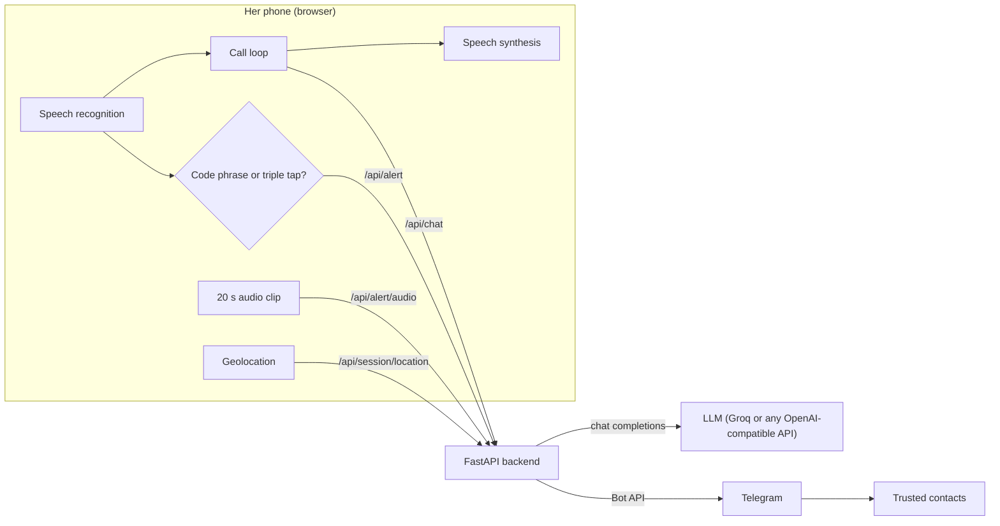

# Saathi (साथी)

An AI phone call that keeps you company when you don't feel safe, and quietly alerts the people you trust the moment you say a code phrase.

**Track:** Artificial Intelligence, also submitted for the Women Safety award.

## The problem

Many women travel alone at night: in cabs and autos, walking home from a station, or leaving a late shift. When a situation starts to feel wrong, the usual advice is to call someone and stay on the phone. But there isn't always someone free to pick up, and the safety apps that exist assume you can openly press a panic button. That's hard to do when the person making you uneasy is sitting beside you, watching your screen, and doing it openly can make things worse.

<!-- Add one or two current figures here from NCRB's "Crime in India" report, with a link. -->

Fake-call apps try to fill the gap, but they play a scripted recording. It can't answer back, so it falls apart as soon as anyone listens closely. And it doesn't tell anyone where you are.

## The solution

Saathi is a real conversation and a silent alarm in one screen.

1. She taps **Start call**. Her phone shows what looks like an ordinary incoming call from "Didi", or whoever she chose as her caller.
2. The caller talks back in real time. It asks where she is and how far she is from home, and mentions that dinner is waiting, in Hinglish if she uses it. Anyone nearby hears her chatting with someone who is expecting her.
3. Her trusted contacts get a Telegram message and a live location pin that moves with her.
4. If she feels unsafe, she says her code phrase (for example, "did you feed the cat?") or taps the caller's photo three times. Her contacts immediately get an alert with her location, followed by a 20-second audio clip. Her phone buzzes twice so she knows the alert went through. Then the caller says out loud that it has her location open, can see exactly where she is, and has sent it to the others too. This is a deterrent aimed at whoever is listening.

### What's new

- **A conversation instead of a recording.** The caller is a language model that responds to what she says, so the call holds up under scrutiny.
- **A covert trigger.** The alert is a normal sentence she might say on any call, so nothing visible happens on screen.
- **The AI becomes the deterrent.** After the alert, the caller tells anyone nearby, out loud, that her location is being watched. It only says this if the alert actually reached at least one contact. If delivery fails, her phone gives one long buzz instead, so she never gets false reassurance.
- **Nothing to install.** It runs in a mobile browser, and contacts only need Telegram.

## How it works



**Turn-taking.** The browser listens with the Web Speech API. When she pauses for about a second, her sentence goes to `/api/chat`. The backend adds a system prompt that sets up the caller's persona, sends the conversation to the LLM, and trims the reply to a few short spoken sentences. The browser then speaks the reply and starts listening again. Listening pauses while the caller speaks, so it never hears itself. If she goes quiet for 20 seconds, the caller checks in ("Hello? Are you there?"), like a real person would.

**Code phrase detection.** The phrase is matched on interim speech results, so the alert is sent the moment the phrase is heard, before she finishes her sentence. Matching ignores punctuation and case, and for phrases of four or more words it tolerates one misheard word.

**Alert-aware replies.** When an alert is delivered, the next request to `/api/chat` carries a flag. The flag switches the prompt so the caller tells the listener that her location is being watched, without using words like "alert" or "emergency".

**Location.** At the start of the call, the backend sends each contact a Telegram live location (`sendLocation` with `live_period`) and moves the pin every few seconds (`editMessageLiveLocation`). If she turned live sharing off, the live pin starts at the moment of the alert. If a call ends after an alert, the pin is left running, because the last known position matters if her phone was taken.

**Privacy.** The LLM key stays on the server. Her settings and contacts are stored only in her own browser. The server keeps no transcripts. A call's session holds only the contact IDs and Telegram message IDs, in memory. The audio clip goes only to her contacts.

## Tech stack

| Part | Tools |
| --- | --- |
| Frontend | HTML, CSS, vanilla JavaScript; Web Speech API (SpeechRecognition, speechSynthesis), Geolocation, MediaRecorder, Screen Wake Lock, Vibration API |
| Backend | Python, FastAPI, Uvicorn, httpx |
| AI | Any OpenAI-compatible chat completions API (Groq by default, for low latency) |
| Alerts | Telegram Bot API (live location, messages, audio documents) |
| Hosting | Render, or any host that serves HTTPS |

## Setup

You need Python 3.10 or newer, Chrome or Edge (desktop or Android), and a Telegram account.

**1. Install**

```bash
git clone <your-repo-url> saathi
cd saathi
python -m venv .venv
source .venv/bin/activate          # Windows: .venv\Scripts\activate
pip install -r backend/requirements.txt
cp .env.example .env               # Windows: copy .env.example .env
```

**2. Create the Telegram bot**

1. In Telegram, open **@BotFather**, send `/newbot`, and follow the prompts.
2. Paste the token it gives you into `.env` as `TELEGRAM_BOT_TOKEN`.
3. Ask each trusted contact to open your bot and send `/start`. A bot can't message anyone who hasn't done this.

**3. Add an LLM key**

Create a key at [console.groq.com](https://console.groq.com) and paste it into `.env` as `LLM_API_KEY`. Model names change over time, so check what's currently available:

```bash
curl https://api.groq.com/openai/v1/models -H "Authorization: Bearer <your key>"
```

Pick a fast chat model and set it as `LLM_MODEL`. For reasoning models, keep `LLM_REASONING_EFFORT=low`; for other models, leave it empty. To use a different provider, change `LLM_BASE_URL` (see `.env.example`). If no key is set, calls still work, using a few pre-written lines.

**4. Run**

```bash
uvicorn backend.main:app --reload
```

Open http://localhost:8000 in Chrome. Enter your name, choose a caller and a code phrase, click **Find contacts**, tick who should get alerts, and click **Send a test message** to check that it arrives. Then click **Start call**.

**Testing on a phone.** Browsers only allow the microphone and location over HTTPS, or on localhost. To try Saathi on your phone, either deploy it (below) or expose your laptop with a tunnel such as `ngrok http 8000`.

### Deploy on Render

1. Push the repo to GitHub, then on Render create a **Web Service** from it.
2. Set the build command to `pip install -r backend/requirements.txt`.
3. Set the start command to `uvicorn backend.main:app --host 0.0.0.0 --port $PORT`.
4. Add the variables from `.env.example` under **Environment**.

Free instances sleep after a period of inactivity, so open the app a minute before a demo.

## API

| Method and path | Purpose |
| --- | --- |
| `GET /api/health` | Whether the LLM and Telegram are configured, and the bot's username |
| `POST /api/chat` | Next line from the caller, given the conversation so far |
| `GET /api/contacts/discover` | People who have sent `/start` to the bot |
| `POST /api/test-alert` | Sends a test message to the chosen contacts |
| `POST /api/session/start` | Tells contacts a call started and begins live location |
| `POST /api/session/location` | Moves the live location pin (throttled to once every 8 s) |
| `POST /api/alert` | Sends the silent alert with location |
| `POST /api/alert/audio` | Forwards the audio clip recorded after an alert |
| `POST /api/session/end` | Tells contacts the call ended |

## Project structure

```
saathi/
├── backend/
│   ├── main.py            # FastAPI app: LLM proxy, Telegram alerts, static files
│   └── requirements.txt
├── frontend/
│   ├── index.html         # Setup screen and call screen
│   ├── style.css
│   └── app.js             # Call loop, code phrase detection, location, alerts
├── .env.example
└── README.md
```

## Demo video outline

1. **The problem (20 s).** A woman is alone in a cab at night and the driver takes a turn she doesn't recognise.
2. **Setup (20 s).** Choose the caller and code phrase, find contacts, and send a test message.
3. **The call (60 s).** Turn on captions for the video. Have a short natural conversation, then say the code phrase.
4. **The alert (30 s).** Show the contact's Telegram on a second phone: the alert, the live pin moving, and the audio clip. Point out the caller's reply about the location.
5. **How it works and what's next (30 s).**

## Limitations and next steps

- **Browser speech recognition.** It needs an internet connection and works best in Chrome or Edge. On Android it may play a short beep when it restarts, and it pauses when the screen turns off. Saathi keeps the screen awake during a call to avoid this.
- **Audio clip.** Recording alongside speech recognition works in desktop Chrome. Some Android phones may skip the clip.
- **Server restarts.** Sessions live in memory. If the server restarts mid-call, the live pin stops updating, but alerts still go through, because every alert carries its own contact list.
- **No accounts.** Anyone with the URL can use the bot. A real deployment needs user accounts, a flow for linking contacts to each user, and rate limiting.
- **Next steps.** A native Android app (background listening, a lock-screen or power-button trigger), an SMS fallback when there's no data, on-device speech recognition, more Indian languages, and a handoff to 112 India.

## Team

| Name | Role |
| --- | --- |
| Gitika Gangwar | B.Tech CSE (AI & ML), Manipal University Jaipur |
| | |

## Credits

Icons adapted from [Feather](https://feathericons.com) (MIT licence).
