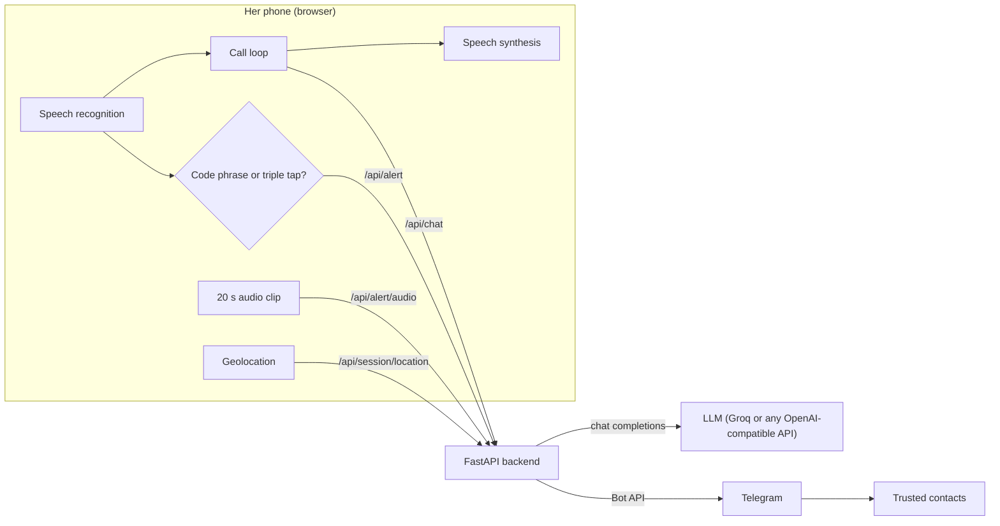

# Saathi (साथी)

An AI phone call that keeps you company when you don't feel safe, and quietly alerts the people you trust the moment you say a code phrase.

**Track:** Artificial Intelligence, also submitted for the Women Safety award.

## The problem

Many women travel alone at night: in cabs and autos, walking home from a station, or leaving a late shift. When a situation starts to feel wrong, the usual advice is to call someone and stay on the phone. But there isn't always someone free to pick up, and the safety apps that exist assume you can openly press a panic button. That's hard to do when the person making you uneasy is sitting beside you, watching your screen, and doing it openly can make things worse.

<!-- Add one or two current figures here from NCRB's "Crime in India" report, with a link. -->

Fake-call apps try to fill the gap, but they play a scripted recording. It can't answer back, so it falls apart as soon as anyone listens closely. And it doesn't tell anyone where you are.

## The solution

Saathi is a real conversation and a silent alarm in one screen.

1. She taps **Start call**. Her phone shows what looks like an ordinary incoming call from "Didi", or whoever she chose as her caller.
2. The caller talks back in real time. It asks where she is and how far she is from home, and mentions that dinner is waiting, in Hinglish if she uses it. Anyone nearby hears her chatting with someone who is expecting her.
3. Her trusted contacts get a Telegram message and a live location pin that moves with her.
4. If she feels unsafe, she says her code phrase (for example, "did you feed the cat?") or taps the caller's photo three times. Her contacts immediately get an alert with her location, followed by a 20-second audio clip. Her phone buzzes twice so she knows the alert went through. Then the caller says out loud that it has her location open, can see exactly where she is, and has sent it to the others too. This is a deterrent aimed at whoever is listening.

### What's new

- **A conversation instead of a recording.** The caller is a language model that responds to what she says, so the call holds up under scrutiny.
- **A covert trigger.** The alert is a normal sentence she might say on any call, so nothing visible happens on screen.
- **The AI becomes the deterrent.** After the alert, the caller tells anyone nearby, out loud, that her location is being watched. It only says this if the alert actually reached at least one contact. If delivery fails, her phone gives one long buzz instead, so she never gets false reassurance.
- **Nothing to install.** It runs in a mobile browser, and contacts only need Telegram.

## How it works



**Turn-taking.** The browser listens with the Web Speech API. When she pauses for about a second, her sentence goes to `/api/chat`. The backend adds a system prompt that sets up the caller's persona, sends the conversation to the LLM, and trims the reply to a few short spoken sentences. The browser then speaks the reply and starts listening again. Listening pauses while the caller speaks, so it never hears itself. If she goes quiet for 20 seconds, the caller checks in ("Hello? Are you there?"), like a real person would.

**Code phrase detection.** The phrase is matched on interim speech results, so the alert is sent the moment the phrase is heard, before she finishes her sentence. Matching ignores punctuation and case, and for phrases of four or more words it tolerates one misheard word.

**Alert-aware replies.** When an alert is delivered, the next request to `/api/chat` carries a flag. The flag switches the prompt so the caller tells the listener that her location is being watched, without using words like "alert" or "emergency".

**Location.** At the start of the call, the backend sends each contact a Telegram live location (`sendLocation` with `live_period`) and moves the pin every few seconds (`editMessageLiveLocation`). If she turned live sharing off, the live pin starts at the moment of the alert. If a call ends after an alert, the pin is left running, because the last known position matters if her phone was taken.

**Privacy.** The LLM key stays on the server. Her settings and contacts are stored only in her own browser. The server keeps no transcripts. A call's session holds only the contact IDs and Telegram message IDs, in memory. The audio clip goes only to her contacts.

## Tech stack

| Part | Tools |
| --- | --- |
| Frontend | HTML, CSS, vanilla JavaScript; Web Speech API (SpeechRecognition, speechSynthesis), Geolocation, MediaRecorder, Screen Wake Lock, Vibration API |
| Backend | Python, FastAPI, Uvicorn, httpx |
| AI | Any OpenAI-compatible chat completions API (Groq by default, for low latency) |
| Alerts | Telegram Bot API (live location, messages, audio documents) |
| Hosting | Render, or any host that serves HTTPS |


## Project structure

```
saathi/
├── backend/
│   ├── main.py            # FastAPI app: LLM proxy, Telegram alerts, static files
│   └── requirements.txt
├── frontend/
│   ├── index.html         # Setup screen and call screen
│   ├── style.css
│   └── app.js             # Call loop, code phrase detection, location, alerts
├── .env.example
└── README.md
```

